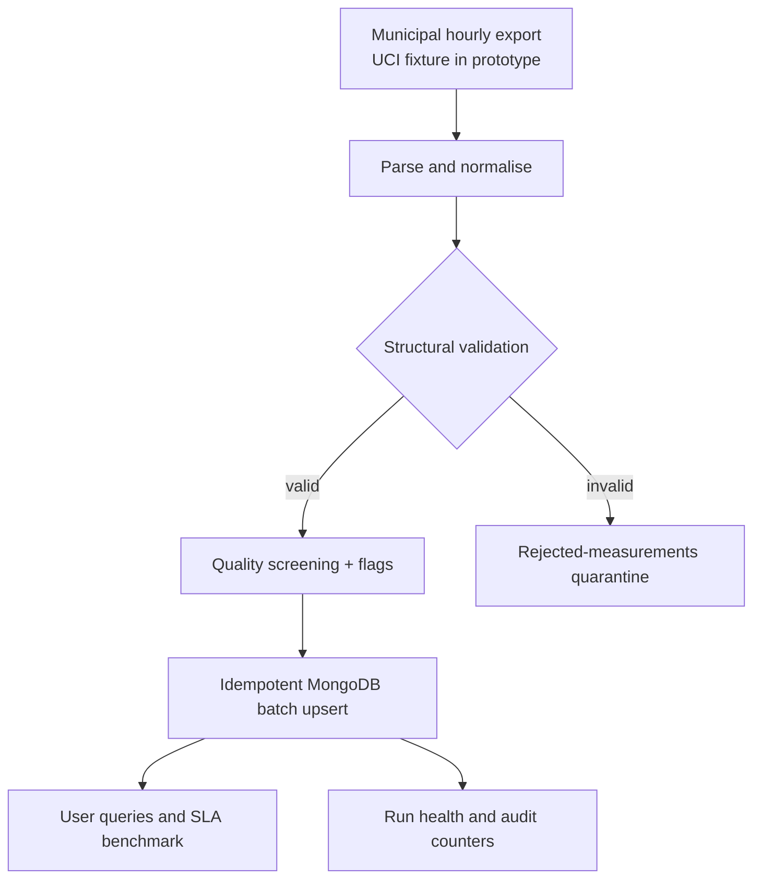

# Municipal Air Quality Decision-Support Pipeline

A stakeholder-driven batch pipeline that turns hourly sensor files into quality-labelled MongoDB records, operational run evidence and bounded-latency query outputs. It is a data layer for municipal applications, not a clinical system and not an autonomous public-warning service.

## Real-life scenario and stakeholders

The intended production setting is a municipality receiving signed hourly exports from its own calibrated monitoring network. The included UCI Beijing dataset is a **historical test fixture** used to exercise scale and missing-data behaviour; it is not evidence about another city.

| Stakeholder | Decision or action | Data contract | Acceptance target |
|---|---|---|---|
| Environmental analyst | Investigate trends, gaps and anomalous readings | Raw station-hour records, quality flags and daily aggregates | Missing/out-of-range values remain visible; no silent zero filling |
| City planner and policy team | Compare areas and before/after periods for interventions | Station comparison with observation counts and date window | One-month comparison completes within the prototype 2 s query SLA |
| Public dashboard developer | Display recent conditions and trend charts | Latest 24 records and daily series by station | Indexed query completes within 2 s; quality status travels with readings |
| Data engineer/steward | Operate and audit the feed | Run status, heartbeat, counters, quarantine and benchmark history | Every run ends `succeeded` or `failed`; source rows reconcile |
| Authorised warning officer | Review threshold candidates before downstream notification | Only quality-accepted candidates plus an approved threshold policy | Prototype sends no alert; missing policy approval blocks notification |

Hourly values can support operational trends, but they may be too coarse or too noisy for some exposure and health questions. A domain owner must define aggregation windows, legal thresholds and acceptable uncertainty before such use.

## Architecture



## Dataset limitations and bias controls

The UCI Beijing Multi-Site Air Quality fixture contains 420,768 hourly rows from 12 stations for 2013-2017. Its CSV files do not provide enough metadata here to establish sensor calibration, measurement precision, station siting, spatial representativeness or independence between nearby stations. Government publication is not treated as proof of correctness. Consequently:

- the pipeline preserves source values and flags them instead of “correcting” them;
- missing pollutant values remain absent, never zero;
- structural failures go to a quarantine collection with a reason;
- screening ranges are configurable technical plausibility checks, not medical limits;
- counts and completeness accompany aggregates so users can see the evidence base;
- the stored source metadata explicitly marks spatial and health-policy validation as incomplete.

Production onboarding would require a station registry with coordinates, sensor model, calibration and maintenance history; signed source manifests; an approved retention policy; and comparison against independent reference monitors.

Source: <https://archive.ics.uci.edu/dataset/501/beijing+multi+site+air+quality+data>

## Data model and reliability

Each measurement document represents one station-hour. Its deterministic `_id` (`station|local ISO timestamp`) and `$setOnInsert` upsert make retries and full replays idempotent. MongoDB stores the timezone-aware instant while `source_timezone` preserves interpretation. `measurements` is flexible for future metrics; shared fields and the embedded `quality` object are schema-validated.

Collections:

- `measurements` - readings, provenance and quality assessment;
- `rejected_measurements` - structurally unusable input rows and rejection reason;
- `ingestion_runs` - status, heartbeat, duration and reconciliation counters;
- `query_benchmarks` - repeatable response-time evidence;
- `source_metadata` - purpose, expected row count and known limitations.

Indexes cover station/time lookup, cross-station time windows and quality/time review. Writes use batches of 1,000 and bounded exponential backoff for transient MongoDB errors. Before a run can be marked successful, source, classification, stored and quarantine counters must reconcile, and the fixture row count must equal the configured expectation. A single local MongoDB container demonstrates portability, not high availability; a production service needs secrets, TLS, backups, a replica set and measured shard-key design.

## Run and verify

Requirements: Docker Desktop or Docker Engine with Compose.

```bash
docker compose down -v
docker compose up --build
```

In another terminal, inspect operational health and quality:

```bash
docker compose run --rm ingest python -m src.monitoring
docker compose run --rm ingest python -m src.queries quality
```

Run the four stakeholder query checks with a 2,000 ms target:

```bash
docker compose --profile verification up --build --exit-code-from verify
```

Run an individual query or review example alert candidates:

```bash
docker compose run --rm ingest python -m src.queries trend --station Aotizhongxin --pollutant pm25
docker compose run --rm ingest python -m src.queries compare --pollutant pm25
docker compose run --rm ingest python -m src.queries alerts --thresholds config/alert_thresholds.example.json
```

The threshold file is deliberately marked `example_not_approved`. Candidate generation neither interprets health risk nor sends notifications.

Run unit tests:

```bash
python -m unittest discover -s tests -v
```

Reproduce the source quality profile without MongoDB:

```bash
python -m src.profile_dataset
```

The verified fixture profile is committed as `validation/dataset_profile.json`: 420,768 rows, of which 383,964 pass all configured checks and 36,804 carry warnings. No source row is structurally rejected; 36,788 rows lack at least one required pollutant and 16 contain at least one value outside a screening range. Warning records remain queryable.

## Acceptance and failure criteria

A prototype run succeeds when: all 420,768 source rows reconcile as stored or quarantined; duplicate station-hour keys are zero; a replay creates no additional measurements; each run has terminal status and counters; quality summaries are queryable; and all four benchmark queries meet the configured 2 s target in the stated local environment. Any unreconciled row, schema error, silent imputation, failed run, unapproved public notification or missed query target is a failure requiring investigation.

## Repository structure

- `src/ingest.py` - download, quarantine, batch, retry, upsert and run counters
- `src/transform.py` - deterministic normalisation and provenance
- `src/quality.py` - configurable completeness and plausibility flags
- `src/queries.py` - stakeholder queries, alert candidates and latency benchmark
- `src/monitoring.py` - operational run-health report
- `config/` - quality rules and non-authoritative threshold example
- `mongo/init.js` - collections, validation, indexes and source limitations
- `tests/` - transformation, quality, idempotency-key and query-contract tests
- `validation/` - reproducible source-profile and benchmark evidence

The assessed portfolio PDFs are intentionally not published in this open repository because they are examination submissions.

## References

- UCI Machine Learning Repository, *Beijing Multi-Site Air Quality Data*: <https://archive.ics.uci.edu/dataset/501/beijing+multi+site+air+quality+data>
- MongoDB, *Data Modeling*: <https://www.mongodb.com/docs/manual/data-modeling/>
- MongoDB, *Schema Validation*: <https://www.mongodb.com/docs/manual/core/schema-validation/>
- MongoDB, *Indexes*: <https://www.mongodb.com/docs/manual/indexes/>
- MongoDB, *Bulk Write Operations*: <https://www.mongodb.com/docs/languages/python/pymongo-driver/current/crud/bulk-write/>

Repository: <https://github.com/yerkebttt/municipal-air-quality-batch-ingestion>
